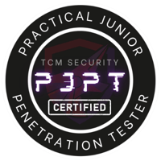

# 410 Gone

The HTTP `410 Gone` client error response code indicates that access to the target resource is no longer available at the origin server and that this condition is likely to be permanent.

**Datacenter Network Technician @ NIXVAL (Valencia IXP)**
Routing · Switching · Network Security · Purple Team

---

## 🚀 About me

Network technician specialized in cybersecurity, with experience across **ISPs, MSPs, enterprise, hospitality, cloud and IXP datacenters**. I design, configure and troubleshoot routing, switching and wireless networks in multi-vendor environments: MikroTik, Juniper, Fortinet, Huawei, Extreme Networks, Alcatel-Lucent, Grandstream.

Certified on the offensive side, hardened on the operational one — I believe the best seat in the house is the **purple team**.

My homelab (Proxmox · TrueNAS · MikroTik · Wazuh) is my training ground, and I document it relentlessly: [Exposing My Homelab](https://410g0n3.medium.com/exposing-my-homelab-ii-bdbff69345de)

## 🧰 Tech stack

**Platforms & virtualization**

     

**Networking vendors**

    

**Protocols & domains**

        

**Tooling & scripting**

    

## 🌟 Certifications

| | | |
|:---:|:---:|:---:|
|  |  |  
|  |   |

## 📚 Courses

<b>Networking 🌐</b>

- **Juniper Learning** — Open Learning: [JNCIA-Junos](https://learningportal.juniper.net/juniper/user_activity_info.aspx?id=EDU-JUN-WBT-JOL-JNCIA-JUNOS) · [JNCIA-DC](https://learningportal.juniper.net/juniper/user_activity_info.aspx?id=EDU-JUN-WBT-JOL-JNCIA-DC)
- **RIPE Academy** — [BGP Security](https://academy.ripe.net/course/view.php?id=15)
- **Udemy** — [Fortinet 7.x: From beginner to expert](https://www.udemy.com/course/fortinet-7-de-principiante-a-experto/)
- **Fortinet Training Institute** — [FCA: FortiGate 7.4 Operator](https://training.fortinet.com/course/view.php?id=39326)
- **Udemy** — [MikroTik: From beginner to expert](https://www.udemy.com/course/mikrotik-de-principiante-a-experto/)

<b>Cybersecurity 🔒</b>

- **Centri** - [Blue Team Level 1 (BTL1)](https://www.centri.org/certifications/blue-team-level-1)
- **WiFiChallenge Academy** — [CWP: Certified WiFiChallenge Professional](https://academy.wifichallenge.com/courses/certified-wifichallenge-professional-cwp-esp)
- **TCM Security** — [Practical Ethical Hacking](https://academy.tcm-sec.com/p/practical-ethical-hacking-the-complete-course)
- **Cybrary** — [Linux Fundamentals for Security Practitioners](https://app.cybrary.it/browse/course/linux-fundamentals-for-security-practitioners)
- **Udemy** — [Intro to Bug Bounty Hunting and Web App Hacking](https://www.udemy.com/course/intro-to-bug-bounty-by-nahamsec/) `in progress`

## 📫 Contact

Happy to talk networks, BGP, homelabs and more.

